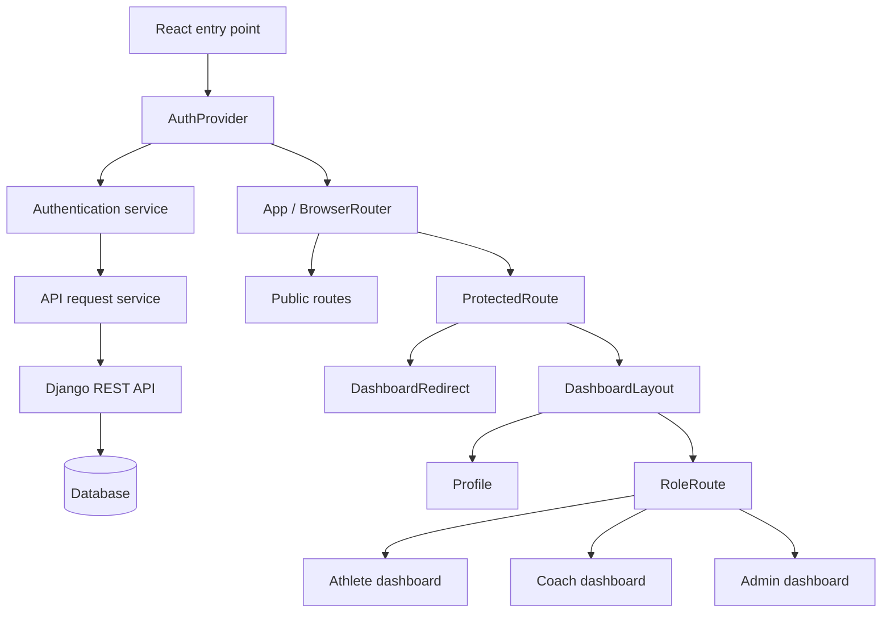

# S1-T08 — Role-Based Routing in React

- **Project:** RepLab — Strength & Conditioning Web & E-Commerce Platform
- **Sprint:** 1
- **Feature branch:** `feature/role-based-routing`
- **Status:** Implemented and locally tested; pending pull request and team review.

## 1. User story and scope

As a user, I want the app to show me only my screens based on my role so that I don't end up where I shouldn't be.

This task implements authentication, role-aware navigation, protected routes, minimal role-specific dashboards, profile provisioning and owner-only profile API access. Workout programming, scheduling, subscriptions and administration features are not implemented by this task.

## 2. Technology stack

| Layer | Technology |
|---|---|
| Frontend | React 19.3.1, Vite 8.3.5 |
| Routing | React Router DOM 7.18.7 |
| Authentication state | React Context and custom hooks |
| HTTP requests | Native Fetch API |
| Backend | Django 6.1.2, Django REST Framework, dj-rest-auth and django-allauth |
| Authentication mechanism used by React | Django session cookies and CSRF protection |
| Database | SQLite for local testing; existing Supabase PostgreSQL integration for shared environments |
| Quality checks | ESLint 10.16.0, Django test suite, manual browser tests |

Versions reflect the locally verified installation. The npm lockfile records the installed dependency versions.

## 3. Architecture



The backend is the source of truth for authentication and role membership. React uses the role returned by the profile API to determine which pages to render. Client-side route guards are not a substitute for backend resource authorization.

### Authentication lifecycle

1. On application startup, `AuthProvider` calls `getCurrentUser()`.
2. The service requests `/api/auth/user/` and `/api/profiles/me/` to retrieve the authenticated account and role.
3. Anonymous sessions cannot access protected pages. Missing or unsupported roles cause authentication verification to fail closed.
4. Login and registration obtain a fresh CSRF token before sending a POST request. The browser retains the Django session cookie.
5. After login, `/dashboard` redirects to the dashboard corresponding to the verified role.
6. Logout sends a CSRF-protected POST to Django. On success the context becomes anonymous, and protected navigation redirects to login.

React does not persist JWTs or passwords in localStorage. Existing backend JWT settings are retained; the React flow uses session authentication rather than JWT authentication.

## 4. Route access policy

| Route | Guest | Athlete | Coach | Admin |
|---|---|---|---|---|
| `/` | Allowed | Allowed | Allowed | Allowed |
| `/login` | Allowed | Own dashboard | Own dashboard | Own dashboard |
| `/register` | Allowed | Own dashboard | Own dashboard | Own dashboard |
| `/dashboard` | Login | Athlete dashboard | Coach dashboard | Admin dashboard |
| `/athlete/dashboard` | Login | Allowed | Access denied | Access denied |
| `/coach/dashboard` | Login | Access denied | Allowed | Access denied |
| `/admin/dashboard` | Login | Access denied | Access denied | Allowed |
| `/profile` | Login | Allowed | Allowed | Allowed |
| `/unauthorized` | Allowed | Allowed | Allowed | Allowed |
| Unmatched route | 404 page | 404 page | 404 page | 404 page |

Roles are `athlete`, `coach` and `admin`. Dashboard permissions are exclusive: an application administrator does not automatically inherit coach or athlete navigation permissions. The application admin role is distinct from Django staff and superuser privileges.

The 403 and 404 pages are client-side screens and do not themselves set HTTP response codes.

## 5. Implementation files

| File or directory | Responsibility |
|---|---|
| `src/main.jsx` | Mounts the authentication provider |
| `src/App.jsx` | Defines public and protected routes |
| `src/services/api.js` | Shared HTTP, CSRF and error handling |
| `src/services/authService.js` | Login, registration, logout and current-user requests |
| `src/context/AuthContext.js` | Authentication context definition |
| `src/context/AuthProvider.jsx` | Session state, loading, errors and action coordination |
| `src/hooks/useAuth.js` | Access to authentication context |
| `src/routes/ProtectedRoute.jsx` | Authentication guard |
| `src/routes/RoleRoute.jsx` | Role guard, deny by default |
| `src/routes/DashboardRedirect.jsx` | Role-to-dashboard redirection |
| `src/layouts/DashboardLayout.jsx` | Shared navigation and logout |
| `src/pages/auth/` | Login and registration forms |
| `src/pages/dashboards/` | Athlete, coach and admin dashboard skeletons |
| `src/pages/Home.jsx`, `Profile.jsx` | Minimal homepage and read-only account profile |
| `src/pages/Unauthorized.jsx`, `NotFound.jsx` | Access denied and fallback screens |
| `backend/config/settings.py` | Development CSRF trusted origins |
| `backend/config/urls.py` | Authentication and CSRF routes |
| `backend/core/auth_views.py` | CSRF token endpoint and POST/CSRF wrapper |
| `backend/core/apps.py`, `signals.py` | Automatic profile provisioning |
| `backend/core/serializers.py`, `views.py` | Owner-only profile API and protected role fields |
| `backend/core/test_auth_permissions.py` | Eight automated authentication and permission tests |
| `backend/core/test_profile_provisioning.py` | Four automated profile provisioning tests |
| `package.json`, `package-lock.json` | Router dependency and dependency security updates |
| `eslint.config.js` | Excludes generated and backend virtual-environment files from frontend linting |

The existing Vite proxy forwards `/api` to `http://127.0.0.1:8000` during development.

## 6. API contract

| Method | Endpoint | Behavior |
|---|---|---|
| GET | `/api/health/` | Public backend health check |
| GET | `/api/auth/csrf/` | Returns a CSRF token and sets the CSRF cookie; not cached |
| POST | `/api/auth/registration/` | Creates an account with username, email and matching passwords; default role is athlete |
| POST | `/api/auth/login/` | Establishes a session using username and password |
| POST | `/api/auth/logout/` | Ends the session |
| GET | `/api/auth/user/` | Retrieves current authenticated account |
| GET | `/api/profiles/me/` | Retrieves current user's profile and role |
| GET | `/api/profiles/` | Lists only the current user's profile |
| GET | `/api/profiles/{id}/` | Retrieves own profile |
| PATCH / PUT | `/api/profiles/{id}/` | Updates permitted own-profile fields; user and role are read-only |

Registration, login and logout require POST and a valid CSRF token. Session-authenticated modifying profile requests also require CSRF. Guests are denied protected profile access; another user's profile returns 404. Attempted role updates are ignored by the serializer and may return 200 without changing the role.

**API compatibility note:** Direct profile creation and deletion through the profile API are now disabled (405). Profiles are automatically created for newly saved users, with `athlete` as the safe default. Existing users without profiles are not automatically backfilled. Coach and admin roles must be assigned through a trusted backend process; a public signup cannot choose these roles.

## 7. Local development setup (Windows PowerShell)

Prerequisites: Git, Node.js compatible with the existing Vite/ESLint toolchain (tested with Node 24), npm, and uv. Start from the repository root after obtaining the feature branch or its merged changes.

Install frontend dependencies from the lockfile:

```powershell
npm ci
```

Terminal 1 — Django backend:

```powershell
cd backend
$env:DJANGO_DB = "sqlite"
uv sync
uv run --no-env-file python manage.py shell -c "from django.db import connection; print(connection.vendor)"
uv run --no-env-file python manage.py migrate
uv run --no-env-file python manage.py runserver 127.0.0.1:8000
```

Confirm the database engine is `sqlite` before running migrations or creating local test users. Do not run this workflow against shared data.

Terminal 2 — React frontend, from the repository root:

```powershell
npm run dev -- --host localhost --port 5173 --strictPort
```

Open `http://localhost:5173/`. Verify `http://localhost:5173/api/health/` returns `{"status":"ok","from":"django"}`.

Use the registration page to create a disposable athlete account. To test privileged dashboards, create separate disposable coach/admin users in the local database and assign their `Profile.role` through the trusted Django backend. Never grant roles through public registration or use production credentials for local testing.

The local `.env`, SQLite database, virtual environment, npm dependencies and generated build output are ignored by Git. `backend/.env.example` contains placeholders only. Do not copy real credentials into tracked files.

## 8. Testing and verification

The following results were recorded during local development on November 28, 2026. Manual browser results were confirmed by the tester; automated results were verified from terminal output.

| Test category | Passed | Failed |
|---|---:|---:|
| Role-based navigation | 36 | 0 |
| Authentication and form validation | 22 | 0 |
| Session and logout | 15 | 0 |
| Automated Django tests | 12 | 0 |
| Manual API security checks | 4 | 0 |
| **Total recorded test cases** | **89** | **0** |

The 89 cases include 77 manual cases and 12 automated cases; repeated runs of the same test suite are not counted again. Some manual and automated checks cover the same behavior. The full Django suite ran 12 tests successfully in 4.874 seconds in the final regression run. This does not imply exhaustive test coverage.

Verified behaviors include guest redirects, dashboard isolation, username case-insensitive login, duplicate registration rejection, password validation, session persistence, logout, safe default roles, denied cross-user profile access, CSRF enforcement and attempted role escalation without a role change.

### Repeat regression checks

From the repository root:

```powershell
npm run lint
npm run build
npm audit
npm audit --omit=dev
git diff --check
```

From `backend/`:

```powershell
$env:DJANGO_DB = "sqlite"
uv run --no-env-file python manage.py test -v 2
uv run --no-env-file python manage.py check
uv run --no-env-file python manage.py makemigrations --check --dry-run
```

Latest verified results: lint/build exit code 0; 41 modules compiled; Django system checks report no issues; no pending model changes. Both npm audits reported zero vulnerabilities after a non-force `npm audit fix` updated ESLint and its transitive development dependencies. Audit results are point-in-time and do not guarantee application security. Git whitespace checks on tracked changes passed; newly added files should be checked after staging.

## 9. Known limitations and follow-up work

- The homepage and dashboards are functional skeletons. Final UI and business features remain assigned to later work.
- Other resource APIs (including workouts, programs and payment plans) require their own backend role and object-level authorization policies before production use.
- Existing shared database accounts without a profile need a reviewed backfill. Preserve existing roles and do not automatically grant privileged application roles based on Django staff status.
- Sessions can become stale in other open tabs until refreshed. The account and profile are fetched separately; a unified session endpoint or identity consistency validation would improve handling of concurrent account changes.
- No automated frontend behavioral test suite was added. Frontend validation consists of manual tests, lint and compilation.
- The authentication feature has been tested against local SQLite, not shared Supabase PostgreSQL. Integration testing against an isolated PostgreSQL environment is still needed.
- Production deployment requires secure secret handling, DEBUG disabled, approved hosts/origins, HTTPS, secure cookies, appropriate session settings, authentication abuse controls, and review of the existing JWT configuration and email verification policy.
- Production routing must support SPA deep links and distinguish the React `/admin/dashboard` route from Django's `/admin/` namespace.
- No new database migrations are needed for this implementation.

## 10. Team handoff

Use `ProtectedRoute` for authenticated pages and `RoleRoute` for role-restricted pages. Add future role-specific features inside the appropriate route group and enforce matching permissions on the backend. Use `useAuth()` to obtain session state; do not derive trusted permissions from user-supplied fields or browser storage.

Before merging, review the changed API contract, dependency security updates and existing-user profile backfill requirements with the team. The feature is ready for final review within its local-development scope; it is not a production release.
